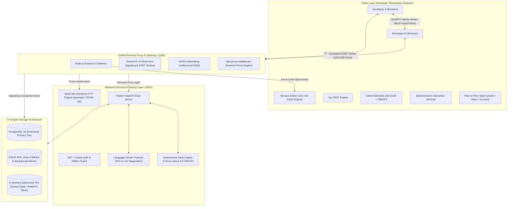
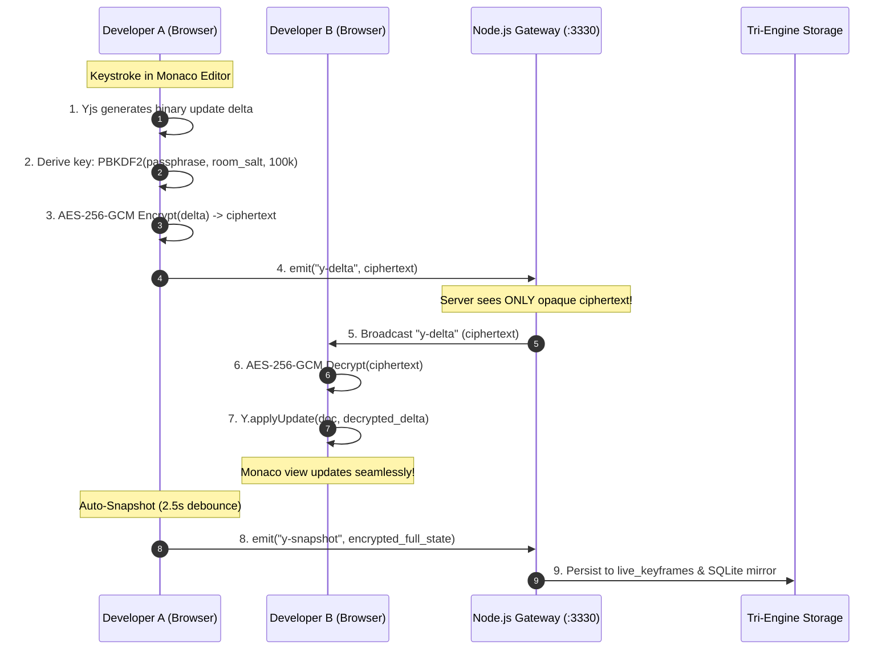

# Nulltor: Cryptographic Collaborative Developer Studio & Localized Version Control Platform
## Master Technical Abstract, Architectural Specification & Presentation Compendium

---

## 1. Executive Abstract & Vision

**Nulltor** is an enterprise-grade, peer-to-peer collaborative development environment (IDE) and localized version control platform engineered for high-security, local area network (LAN), and air-gapped environments. Nulltor converges the real-time collaborative editing of **VS Code**, the branch governance, code reviews, and commit integrity of **GitHub**, the embedded team communication of **WebRTC**, and the cognitive assistance of an **Autonomous AI Software Engineering Agent** into a single, self-hosted platform.

### The Core Problem Solved
Traditional collaborative developer platforms (e.g., GitHub Codespaces, Replit, Google Docs) mandate unencrypted source code transmission to remote third-party cloud infrastructure. This exposes intellectual property, defense software, and proprietary algorithms to external data breaches, foreign surveillance, and compliance violations (SOC2, HIPAA, GDPR, ISO 27001). Conversely, legacy local development lacks frictionless peer-to-peer real-time synchronization, visual merge review governance, and integrated collaboration.

### The Nulltor Paradigm
Nulltor eliminates the cloud dependency paradox by enforcing a **Zero-Knowledge, Zero-Trust Architecture**. Source code, CRDT synchronization deltas, and file snapshots are encrypted **client-side in the browser** using military-grade **AES-256-GCM** before touching any network wire or storage engine. The host server and centralized gateway operate in complete cryptographic blindness—holding only opaque ciphertext without possessing the workspace decryption key. Combined with a resilient **Tri-Engine Storage architecture** (PostgreSQL + SQLite WAL fallback + In-Memory), **mDNS zero-configuration discovery**, **native PTY terminals**, and **LSP intelligence**, Nulltor delivers uncompromised speed, security, and developer ergonomics.

---

## 2. System Architecture & Component Topology

---

## 3. Deep Dive: Unique Selling Propositions (USPs)

### USP 1: Zero-Knowledge & Zero-Trust Client-Side Cryptography (E2EE)
* **Client-Side AES-256-GCM**: Encryption and decryption occur exclusively inside the developer’s browser using `@noble/ciphers` and `crypto-js`. Source code never touches the network in plaintext.
* **PBKDF2-HMAC-SHA256 Key Derivation**: Symmetric 256-bit keys are derived from the workspace passphrase using **100,000 iterations** salted with a cryptographically secure 128-bit `room_salt` generated per project.
* **Server Blindness**: The gateway and database store only opaque ciphertext payloads (`iv + authTag + ciphertext`). A rogue server administrator, compromised database host, or man-in-the-middle packet sniffer cannot decrypt or inspect source code.
* **Protective Anti-Overwrite Locking**: If an incorrect passphrase is provided or decryption fails, Nulltor immediately places the editor into a protective read-only state, rendering an in-editor alert banner with a "Re-enter Passphrase" action. It strictly blocks blanking or corrupting the project's encrypted snapshots.

### USP 2: Tri-Engine Hybrid Storage & Fault-Tolerant Resilience
Nulltor resolves the fragility of single-point database architectures through a three-tier hybrid database topology:
1. **Tier 1: PostgreSQL Enterprise Tier (Primary)**: High-concurrency relational database handling user authentication, project governance, memberships, audit logging, and Content-Addressed Storage (CAS) commit trees.
2. **Tier 2: SQLite WAL Auto-Fallback & Mirror Tier (Local / Air-Gapped)**: If PostgreSQL is absent or experiences a network partition, Nulltor automatically and transparently falls back to an embedded SQLite database (`nulltor.db`) running in Write-Ahead Logging (`WAL`) mode (`PRAGMA journal_mode=WAL`). An automated background replication worker (`db-mirror`) continuously mirrors PostgreSQL commits, live keyframes, and CAS blobs into SQLite for instant air-gapped readiness.
3. **Tier 3: In-Memory Ephemeral Tier**: Ultra-fast in-memory state management in the Node.js gateway managing active Socket.IO rooms, peer cursors, live presences, and WebRTC SDP/ICE candidate signaling.

### USP 3: Decentralized CRDT Synchronization (Yjs + Socket.IO)
* **Conflict-Free Replicated Data Types (CRDT)**: Powered by `yjs`, Nulltor resolves concurrent multi-user edits mathematically without server-side merge locks. Edits converge deterministically across all peers.
* **Branch-Isolated Rooms**: Rooms are namespaced as `${fileId}::${branchId}`, ensuring that feature branches and private vaults maintain entirely independent undo/redo stacks and edit histories.
* **Aggressive Self-Healing Reconnection**: Built-in listeners detect window focus, network reconnects, and laptop wake-from-sleep events, instantly re-requesting missing CRDT updates (`request-sync`) to eliminate stale drift.
* **Synchronous `docRef` State Bridge**: Eliminates React asynchronous closure lag by keeping a live reference to the Yjs document, ensuring instantaneous capture of rapid keystrokes.

### USP 4: Git-Equivalent Version Control & Branch Governance (CAS)
* **Atomic Content-Addressed Storage (CAS)**: Files and commits are stored as immutable, content-addressed SHA-256 blobs, preventing history tampering.
* **Multi-Branch Topology**: Full support for canonical `main` (trunk), collaborative subrooms, and private developer vaults.
* **Code Reviews & Decentralized Merge Requests**: Pull request engine featuring line-by-line visual diff rendering (`react-diff-view`), approval workflows, and audit records.
* **Proactive Merge Conflict Detection**: Automatically flags merge requests with `has_conflict: true` if the target branch advanced after the merge request was created. Displays visual `⚠️ CONFLICT` badges in the review panel and amber/red alert warning banners in the diff modal.

### USP 5: Multi-Tab Interactive Terminal (Native PTY Engine)
* **Native Operating System PTY Execution**: Employs `pywinpty` on Windows and native `pty` on POSIX systems to spawn genuine interactive shell sessions (PowerShell, CMD, Bash, Zsh).
* **Multi-Tab Concurrency**: Developers can launch and toggle multiple independent terminal sessions simultaneously.
* **ANSI Terminal Rendering**: Powered by `@xterm/xterm` with `@xterm/addon-fit` and custom high-contrast dark/light theme palettes.
* **Cryptographic WebSocket Guard**: Terminal connections over `/ws/terminal` enforce JWT verification, preventing unauthorized shell hijacking.

### USP 6: Autonomous AI Software Engineering Agent
* **ReAct Loop Agent**: An embedded autonomous agent operating via a Reason + Act cycle capable of inspecting workspaces, modifying files, executing terminal commands, and performing atomic git commits.
* **Multi-Model Inference**: Integrates with Groq Cloud (Llama-3.3-70B-Versatile) for sub-second streaming inference, with compatibility for local Ollama and OpenAI-compatible endpoints.
* **Agent Spotlight (Ctrl+K) & Inline Copilot**: Floating prompt bar for targeted refactoring, unit test generation, security audits, and docstring injection, featuring visual AI line-change shimmer highlights.

### USP 7: Peer-to-Peer WebRTC Audio/Video Mesh
* **In-IDE Direct Calling**: High-definition audio and video conferencing embedded natively within the IDE layout, eliminating external tools (Zoom, Google Meet, Teams).
* **Mesh Signaling**: Uses the unified gateway solely for SDP offer/answer exchanges and ICE candidates; all voice and video data travels directly peer-to-peer between developers.

### USP 8: Air-Gapped / LAN Collaboration & Zero-Config mDNS
* **Zero Internet Dependency**: Complete developer studio functionality (editing, compiling, terminal, version control, reviews, calling) over a local Wi-Fi router or disconnected ethernet switch.
* **mDNS Zero-Config Discovery**: Broadcasts service availability via multicast DNS as `http://nulltor.local:3330`. Developers join instantly without memorizing local IP addresses.
* **Universal LAN CORS Regex**: Automatically validates preflights across all private RFC1918 subnets (`192.168.0.0/16`, `10.0.0.0/8`, `172.16.0.0/12`), localhost, and `.local` domains.

### USP 9: Enterprise RBAC & Multi-Tenant Tab Isolation
* **Granular Role-Based Access Control**: Tiered permissions for `superadmin`, `admin` (project lead), and `member` roles backed by comprehensive `audit_logs`.
* **Deep Data Isolation**:
  - Regular members cannot inspect private branch file trees or rename files (`403 Forbidden`).
  - Cross-project CAS blob requests return `404 Not Found`.
  - AI tools enforce branch access checks prior to action execution.
* **Tab & Session State Scoping**: Editor tabs are strictly keyed by user and project (`nulltor_tabs_${userId}_${projectId}`). Logging out or session expiration purges all in-memory editor stores, preventing session bleed between different users.

### USP 10: VS Code Ecosystem & Open VSX Marketplace
* **Monaco Editor Core**: Built on the exact editing core of Visual Studio Code (`@monaco-editor/react`).
* **Open VSX Marketplace Integration**: Direct search and download integration with the Eclipse Open VSX open-source extension registry.
* **Language Server Protocol (LSP)**: Context-aware linting, error squiggles, and diagnostics for Python, JavaScript, TypeScript, C, C++, and JSON.
* **Instant Code Formatting**: Integrated Prettier engine supporting formatting across JS/TS, Python, C++, HTML, and CSS via `Shift + Alt + F`.

---

## 4. Comprehensive Technology Stack & Library Registry

### 4.1 Frontend Layer (Client SPA)

| Library / Package | Version | Architectural Role | Technical Justification |
| :--- | :--- | :--- | :--- |
| **`react`** / **`react-dom`** | `^19.2.7` | UI Component Framework | Modern React 19 Concurrent Mode, optimized reconciliation, and state-driven interface rendering. |
| **`typescript`** | `~6.0.2` | Static Type Safety | Strict type definitions across IDE states, AST diagnostics, and API contracts. |
| **`vite`** | `^8.1.1` | Build Tool & Bundler | Sub-second HMR, tree-shaking, and optimized production rollups targeting `public_react/`. |
| **`@monaco-editor/react`** | `^4.7.0` | Core Code Editor | High-performance VS Code editor engine with syntax highlighting, minimap, folding, and multi-cursor editing. |
| **`yjs`** | `^13.6.31` | CRDT Collaboration Engine | High-performance Conflict-free Replicated Data Type framework for real-time document synchronization. |
| **`socket.io-client`** | `^4.8.3` | Real-Time WebSocket Client | Bi-directional encrypted delta streaming, presence notifications, and WebRTC signaling. |
| **`@noble/ciphers`** | `^2.3.0` | Audited Cryptography | Zero-dependency, audited, high-speed AES-GCM and Salsa/ChaCha implementations. |
| **`@noble/hashes`** | `^2.3.0` | Cryptographic Hashes | High-speed SHA-256 and PBKDF2 implementations for client-side key derivation and CAS hashing. |
| **`crypto-js`** | `^4.2.0` | Cryptographic Utilities | PBKDF2 key derivation and symmetric cipher orchestration. |
| **`@xterm/xterm`** | `^6.0.0` | Browser Terminal Emulator | Canvas-accelerated terminal rendering supporting full ANSI color codes and escape sequences. |
| **`@xterm/addon-fit`** | `^0.11.0` | Terminal Viewport Fit Addon | Dynamically calculates terminal geometry (rows/columns) on window resize. |
| **`zustand`** | `^5.0.14` | Client State Management | Minimalist, unopinionated global state for editor tabs, auth tokens, diagnostics, and project models. |
| **`react-router-dom`** | `^7.18.2` | Client-Side Routing | Hash-based routing (`/#/login`, `/#/ide`, `/#/dashboard`) guaranteeing zero-configuration static file serving. |
| **`react-diff-view`** | `^3.3.3` | Visual Diff Viewer | GitHub-style side-by-side and unified diff rendering for pull request reviews. |
| **`lucide-react`** | `^1.31.0` | UI Iconography | Crisp, lightweight SVG icons tailored for IDE activities and menus. |
| **`marked`** | `^18.0.11` | Markdown Parser | High-speed parsing and sanitization for documentation, commit logs, and AI agent markdown responses. |
| **`gsap`** / **`motion`** | `^3.15.0` / `^13.2.0` | Micro-Animations | Fluid UI transitions, landing page spotlights, and tab animation polish. |

---

### 4.2 Gateway & Real-Time Server Layer (Node.js)

| Library / Package | Version | Architectural Role | Technical Justification |
| :--- | :--- | :--- | :--- |
| **`express`** | `^5.2.1` | HTTP Gateway & Static Server | Serves compiled React bundles and routes API reverse proxy requests. |
| **`socket.io`** | `^4.8.3` | Real-Time Broker | Manages file-branch rooms, encrypted Yjs deltas, peer presence, and WebRTC signaling. |
| **`http-proxy-middleware`** | `^4.2.0` | Reverse Proxy Engine | Seamlessly proxies `/api/*` to FastAPI (`:8001`) and `/ws/*` to the Python PTY daemon. |
| **`multicast-dns`** | `^7.2.5` | mDNS Service Advertising | Broadcasts `nulltor.local` on port 3330 over the local subnet for zero-config discovery. |
| **`pg`** | `^8.23.0` | PostgreSQL Client | Direct gateway connection to PostgreSQL for CAS blob verification and database mirroring. |
| **`sqlite3`** | `^6.0.1` | SQLite Driver | Local SQLite connection for offline keyframe snapshots and fallback storage. |
| **`dotenv`** | `^17.4.2` | Environment Configuration | Secure runtime environment variable management. |
| **`concurrently`** | `^10.0.5` | Process Orchestration | Coordinates simultaneous startup of FastAPI, Gateway, and Vite dev servers. |

---

### 4.3 Backend API & Services Layer (Python FastAPI)

| Library / Package | Version | Architectural Role | Technical Justification |
| :--- | :--- | :--- | :--- |
| **`fastapi`** | `>=0.104.0` | High-Speed ASGI Framework | Asynchronous, OpenAPI-documented REST API engine handling auth, projects, git trees, and tools. |
| **`uvicorn[standard]`** | `>=0.24.0` | ASGI Web Server | Production ASGI web server running with high-performance event loop (`uvloop`). |
| **`sqlalchemy[asyncio]`** | `>=2.0.23` | Async ORM & DB Layer | Modern async SQL abstraction supporting concurrent database sessions and migrations. |
| **`asyncpg`** | `>=0.29.0` | PostgreSQL Async Driver | Ultra-fast binary protocol driver for PostgreSQL operations. |
| **`aiosqlite`** | `>=0.19.0` | SQLite Async Driver | Non-blocking async driver for SQLite operations. |
| **`alembic`** | `>=1.12.0` | Database Migration Engine | Version-controlled schema migrations for enterprise database evolution. |
| **`pydantic`** / **`pydantic-settings`** | `>=2.4.0` | Data Validation & Schemas | Strict type parsing and validation for incoming HTTP request payloads and responses. |
| **`python-jose[cryptography]`** | `>=3.3.0` | JWT Token Generation & Verification | Secure HS256/RS256 JWT access and refresh token minting. |
| **`passlib[bcrypt]`** / **`bcrypt`** | `==3.2.2` | Password Hashing | Secure salted bcrypt hashing for user credentials. |
| **`pywinpty`** / **`pty`** | Native | Interactive Shell Engine | OS-level pseudo-terminal allocation for interactive multi-tab shell sessions. |
| **`httpx`** / **`requests`** | `>=0.25.0` | Async HTTP Client | Asynchronous communication with external LLMs, Open VSX, and webhook endpoints. |
| **`numpy`**, **`pandas`**, **`scipy`**, **`scikit-learn`**, **`tensorflow`** | Latest | Data Science & ML Sandbox | Pre-installed compute libraries available in the execution sandbox for local data processing. |
| **`beautifulsoup4`** | `>=4.12.0` | HTML & Scraping Tool | Content parsing tool used by the autonomous AI agent. |

---

## 5. End-to-End Data Flow Lifecycles

### 5.1 Real-Time Collaborative Edit Flow (Zero-Knowledge)

### 5.2 Merge Request & Conflict Detection Flow
1. Developer creates a branch from `main`: `POST /projects/{id}/branches`.
2. Developer commits changes into atomic CAS blobs: `POST /projects/{id}/commits`.
3. Developer files a Merge Request: `POST /projects/{id}/merges`.
4. The system inspects commit history on `target_branch_id`:
   - If commits exist on `main` created after `mr.created_at`, backend computes `has_conflict = True`.
   - UI renders `⚠️ CONFLICT` badge on the Merge Review card.
   - Diff modal surfaces an amber/red warning banner detailing divergence and guiding the reviewer.
5. Project Lead reviews line-by-line diffs via `react-diff-view` and clicks **Approve & Merge**.
6. Commits, CAS blobs, and file tree nodes are atomically merged into the `main` branch.

---

## 6. Deployment Modes & Operational Models

| Deployment Mode | Command / Target | Target Use Case | Key Features |
| :--- | :--- | :--- | :--- |
| **Universal Self-Healing Startup** | `npm start` | Individual developers, local teams, classroom labs. | Auto-bootstraps Python venv, installs dependencies, verifies frontend build, and starts unified server on `:3330`. |
| **Zero-Config LAN Mode** | `http://nulltor.local:3330` | Air-gapped rooms, hackathons, disconnected field networks. | mDNS auto-discovery broadcast; team members connect instantly without knowing IP addresses. |
| **Enterprise Docker Stack** | `docker compose up --build` | Corporate intranets, defense labs, on-prem cloud. | Orchestrates Gateway (`:3330`), FastAPI (`:8001`), and PostgreSQL (`:5432`) with health checks and restart policies. |
| **Developer Hot-Reload** | `npm run dev` | Feature development and customization. | Concurrent live reload for FastAPI, Nodemon for gateway, and Vite HMR for React frontend. |

---

## 7. Presentation Script & Defense Talking Points

*Use these structured talking points for presentations, slide pitch voiceovers, and technical panel defense:*

### 30-Second Elevator Pitch
> *"Nulltor is an enterprise-grade collaborative development platform designed for high-security and air-gapped networks. It unites the real-time editing of VS Code, the version control and code review workflows of GitHub, integrated WebRTC calling, and an autonomous AI coding agent—all secured by client-side Zero-Knowledge encryption. With Nulltor, your code never leaves developer machines in plaintext, the host server is completely cryptographically blind, and your entire engineering team can collaborate over a local Wi-Fi router without an internet connection."*

### 3-Minute Presentation Script Blueprint

1. **The Hook (Slide 1 — The Problem)**:
   - *"Every day, engineering teams leak proprietary code to third-party cloud IDEs. For defense contractors, healthcare platforms, and security-critical enterprises, cloud dependency is a catastrophic compliance and data breach risk. But existing local tools isolate developers into offline silos without real-time collaboration or governance."*
2. **The Solution (Slide 2 — Enter Nulltor)**:
   - *"Nulltor solves this with a Zero-Trust architecture. It runs 100% locally or over a private LAN. When two developers edit code, updates are synchronized via Yjs CRDTs and encrypted client-side in the browser using AES-256-GCM. The server only sees encrypted noise."*
3. **The Core USPs (Slide 3 & 4 — Technical Architecture)**:
   - **Zero-Knowledge Privacy**: *"Keys are derived via PBKDF2 with 100,000 iterations. Even if an attacker gains root access to our server or database, they see zero plain source code."*
   - **Tri-Engine Storage**: *"We utilize a 3-tier resilient storage model: PostgreSQL for high-concurrency enterprise workloads, automatic SQLite WAL fallback for zero-config offline resilience, and in-memory brokers for low-latency WebRTC and cursor signaling."*
   - **GitHub-Equivalent Governance**: *"Nulltor isn't just an editor; it's a full version control studio with branching, immutable CAS commits, code review diffs, and proactive merge conflict alerts."*
4. **Live Capabilities (Slide 5 — The Experience)**:
   - *"Inside the studio, developers get full VS Code Monaco ergonomics, native multi-tab PowerShell/Bash terminals, direct WebRTC mesh video calling, and an autonomous AI agent capable of writing, refactoring, and committing code."*
5. **The Closing (Slide 6 — Impact)**:
   - *"Nulltor delivers the collaborative velocity of Google Docs, the code governance of GitHub, and the security of an air-gapped vault. Zero cloud leaks. Zero configuration. 100% data sovereignty."*

---

## 8. Summary Checklist for Technical Evaluators

- [x] **Zero-Knowledge End-to-End Encryption**: Client-side AES-256-GCM + PBKDF2 (100k rounds) verified.
- [x] **Tri-Engine Storage**: PostgreSQL primary + SQLite WAL fallback + In-Memory tier verified.
- [x] **Real-Time Collaboration**: Yjs CRDT sync over branch-isolated Socket.IO rooms verified.
- [x] **Version Control & Reviews**: CAS SHA-256 blobs, pull requests, and merge conflict warnings verified.
- [x] **Native Shell Execution**: Multi-tab PTY terminal engine with JWT WebSocket protection verified.
- [x] **Autonomous AI Agent**: ReAct execution loop with tool execution and streaming Groq LLM verified.
- [x] **Air-Gapped & LAN Readiness**: Multicast DNS (`nulltor.local:3330`) and universal private subnet CORS verified.
- [x] **Strict RBAC & Data Isolation**: Multi-tenant authorization, private branch protections, and tab isolation verified.
